<a href="https://sarveshsingh09.netlify.app/">
  
</a>

  
  
  
  
  

  
  

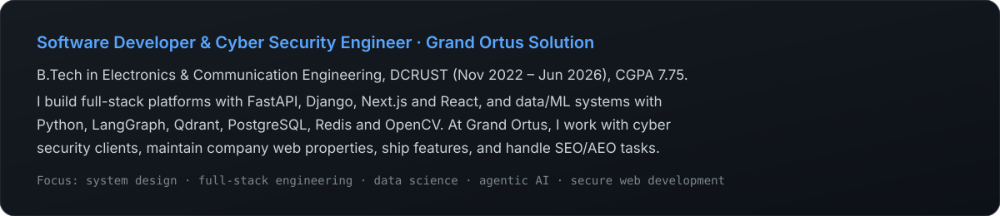

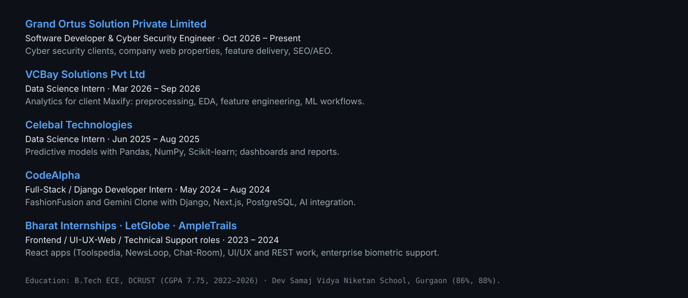

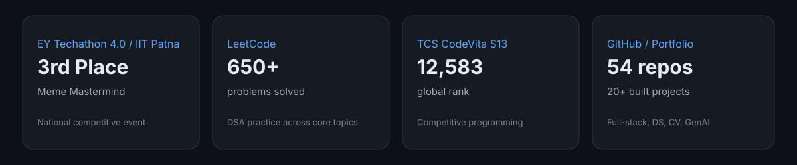

  
  
  


<a href="https://github.com/sarveshsinghthakur/codeforge-ai">
  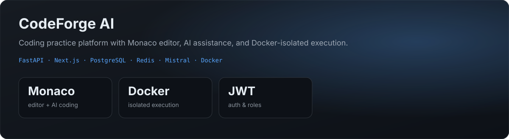
</a>

  

<a href="https://github.com/sarveshsinghthakur/dotrag">
  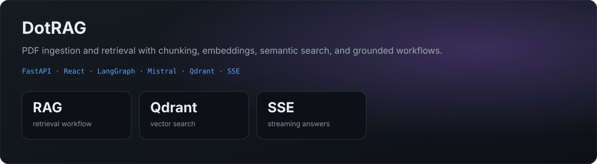
</a>

  

<a href="https://github.com/sarveshsinghthakur/healthcare-backend">
  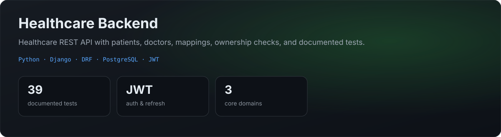
</a>

  

<a href="https://github.com/sarveshsinghthakur/vitto-loan-repayment-service">
  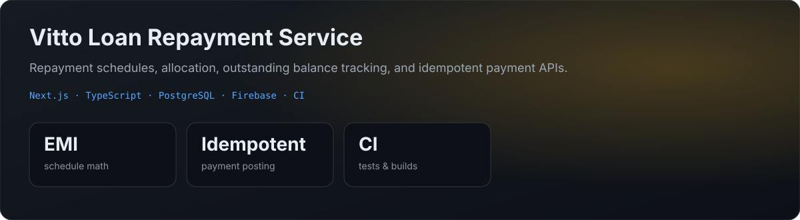
</a>

  

  
<b>More verified projects from my portfolio</b>

   

| Project | Focus | Stack | Repository |
|---|---|---|---|
| BOOM - ZOOM Clone | Web-based conferencing | Next.js, TypeScript, WebRTC | [sarveshsinghthakur/BOOM---ZOOM_Clone---](https://github.com/sarveshsinghthakur/BOOM---ZOOM_Clone---) |
| FashionFusion | E-commerce platform | Django, Python, HTML/CSS | [sarveshsinghthakur/FashionFusion](https://github.com/sarveshsinghthakur/FashionFusion) |
| Livedocs | Real-time collaborative docs | Next.js, TypeScript | [sarveshsinghthakur/Livedocs](https://github.com/sarveshsinghthakur/Livedocs) |
| Facial Recognition Attendance | Computer vision attendance | Python, OpenCV, ML | [sarveshsinghthakur/Facial_Recognition](https://github.com/sarveshsinghthakur/Facial_Recognition) |
| SMS Spam Classifier | Text classification service | Python, Scikit-learn, FastAPI, TF-IDF | [sarveshsinghthakur/sms-spam-classifier](https://github.com/sarveshsinghthakur/sms-spam-classifier) |
| Credit Card Fraud Detection | ML classification workflow | Python, Pandas, NumPy, Scikit-learn | Portfolio-listed project |

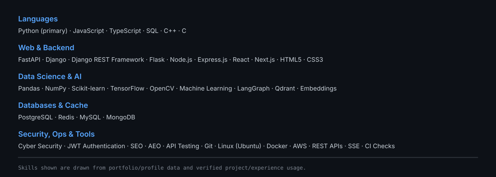

  
  
  
  
  
  
  
  
  
  
  
  
  
  
  


  
  

  
  

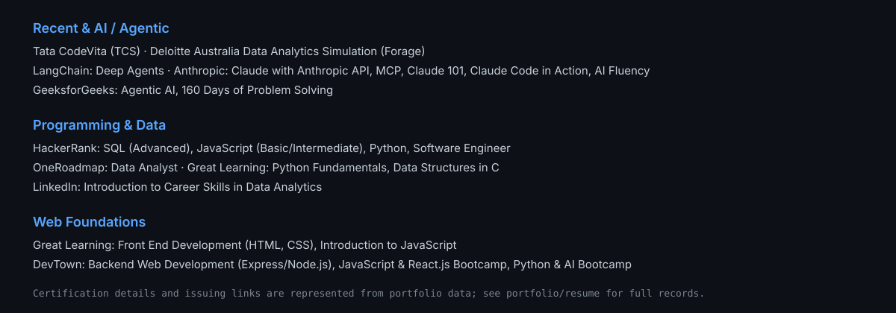


  
  
  
  
  

  Primary content source: updated portfolio data for Sarvesh Singh · GitHub username: <code>sarveshsinghthakur</code>

<a href="https://sarveshsingh09.netlify.app/">
  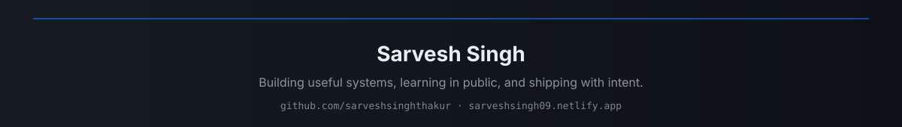
</a>